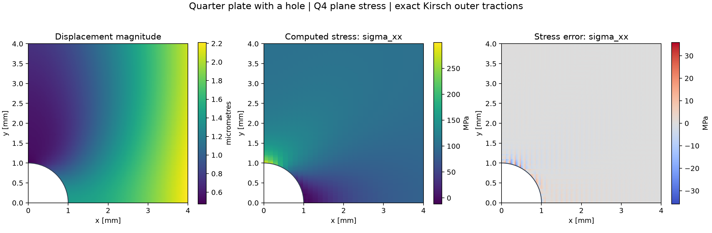
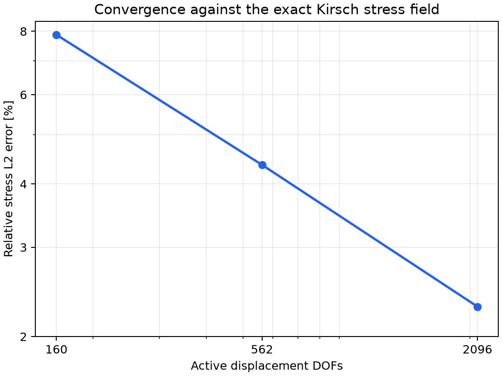

# Immersed Elasticity: a Verified Plate-with-Hole Solver

A Python implementation of 2D, small-strain plane-stress elasticity on a Cartesian
background mesh. A circular hole cuts through bilinear quadrilateral elements;
adaptive quadtree quadrature integrates the material without a body-fitted mesh.

**V1 result:** the relative stress L2 error decreases from **7.88% to 2.29%** under
mesh refinement, using an exact analytical stress reference. The verification
suite covers affine displacement reproduction, uniaxial tension, reaction balance,
cut-domain area integration, and convergence of the immersed solution.



## Motivation and relationship to the paper

Inspired by Schmäke, Wege, and Ruess, *Efficient Thermo-Viscoplastic Analysis Using
a Multi-Level hp-Finite Cell Method with Non-Negative Moment Fitting*,
[arXiv:2604.15921v2](https://arxiv.org/abs/2604.15921v2).

This repository is an independent educational implementation of a **simplified
immersed linear-elastic baseline**. It is not a full replication, and its results
are not reproductions of the paper's figures or plasticity benchmarks.

| Feature | V1 | Planned V2 or later |
|---|---|---|
| Approximation | Bilinear Q4, plane stress | High-order basis |
| Geometry integration | Adaptive quadtree + Gauss quadrature | Non-negative moment fitting |
| Mesh refinement | Uniform background-grid refinement | Hierarchical overlay refinement |
| Material | Isotropic linear elasticity | Thermoelasticity and inelastic models |
| Reference | Exact Kirsch stress under exact outer tractions | Additional engineering benchmarks |

## Run locally

Requires Python 3.11+; the recorded results use Python 3.12 on Windows. From the
repository root, create an environment and install the project:

```powershell
python -m venv .venv
.\.venv\Scripts\python.exe -m pip install -e ".[dev]"
.\.venv\Scripts\python.exe -m pytest -q
.\.venv\Scripts\python.exe scripts/run_benchmark.py --sensitivity
```

On Linux/macOS, replace `.\.venv\Scripts\python.exe` with `.venv/bin/python`.
After installation, `python -m immersed_elasticity.benchmark --sensitivity` also
works with the environment active. A tested dependency snapshot is provided in
`requirements-lock.txt`; install it before the editable package for exact versions:

```powershell
.\.venv\Scripts\python.exe -m pip install -r requirements-lock.txt
.\.venv\Scripts\python.exe -m pip install --no-deps -e .
```

Output includes `results/metrics.json`, `convergence.csv`, `fields.png`, `mesh.png`,
and `convergence.png`. The JSON records versions, inputs, errors, equilibrium
residuals, energies, and timings. Rerunning overwrites those generated files.
Timings are single-run diagnostics, not a rigorous performance comparison.

### Try your own model

Edit the settings at the top of [`playground.py`](playground.py) to change the
plate dimensions, hole radius, mesh, material, edge tractions, and prescribed
displacements. The example applies a uniform pull to the right edge. Run it
from the repository root after installing the package:

```powershell
.\.venv\Scripts\python.exe playground.py
```

For displacement loading, set `TRACTIONS = {}` and add `"right": (0.01, None)`
to `DISPLACEMENTS`. The tuple prescribes 0.01 mm in x and leaves y free.
The script reports the mean right-edge displacement, total applied force,
support force, and force imbalance. Use `radius=0` for a solid rectangle.
For a positive radius, the circular hole is centered at the origin and the
model contains one quarter of it. The Kirsch reference below applies to the
separate verification benchmark with its analytical outer tractions.

Each run writes `fields.png`, `mesh.png`, and `convergence.png` to
`results/playground/`. The fields and mesh use the grid in `GEOMETRY`. The
convergence plot tracks total strain energy as both mesh counts increase
according to `REFINEMENT_MULTIPLIERS`. It shows how that quantity changes with
refinement for your chosen loads and geometry. The benchmark convergence
plot instead measures stress error against the exact Kirsch solution.

## Engineering model

The physical quarter-domain is `[0,4] x [0,4] mm` outside a hole of radius `1 mm`
at the origin. Material parameters are `E = 210000 MPa`, `nu = 0.3`, and thickness
`t = 1 mm`. Remote tension in the analytical solution is `100 MPa` in the x direction.

- Symmetry: `ux = 0` on `x = 0`; `uy = 0` on `y = 0`.
- Outer loading: `traction = sigma_Kirsch . normal` on the top and right edges.
- Hole: traction-free in the physical problem, approximated through a soft
  fictitious extension in the discrete formulation.

**Why exact outer tractions?** Kirsch describes an infinite plate. Applying its
analytical traction field to the truncated square makes the same stress field
an exact reference for this finite domain. Uniform outer traction would introduce
a finite-width difference, so the factor of three would not be an exact reference
for that different boundary-value problem.

### Formulation

Engineering strain is `[epsilon_xx, epsilon_yy, gamma_xy]`. The plane-stress
constitutive matrix is

```text
         E       [ 1    nu       0       ]
D = ---------- * [ nu   1        0       ]
     1 - nu^2    [ 0    0    (1 - nu)/2 ]

K_e = thickness * integral( alpha(x) * B^T D B ) dA
```

The indicator is `1` in material and `1e-6` in the fictitious part of active cut
cells. Fully fictitious cells and unused nodes are removed. Interface boxes
subdivide recursively; uncut boxes use a 2x2 Gauss rule. Terminal cut boxes sample
the indicator at Gauss points. This is approximate geometry integration, not an
exact boundary representation. The default maximum subdivision depth is four.

Prescribed displacement DOFs are eliminated exactly. Reactions are recovered
from the original system as `K u - f`. Element strains and stresses are evaluated
directly from the Q4 displacement field. The field figure uses unsmoothed interior
sample values; these plotting samples are not the assembly quadrature points.

## Verification and results

Run `python -m pytest -q` in the configured environment. Eight tests currently pass,
including three parameterized checks rejecting invalid material properties.

| Check | Acceptance criterion |
|---|---|
| Affine displacement patch | Displacements and constant strain reproduced to floating-point tolerance |
| Rectangular uniaxial tension | Exact axial extension and Poisson contraction |
| Load and reaction balance | Global equilibrium within stated test tolerances |
| Cut-domain quadrature | Positive weights and quarter-circle area accuracy |
| Analytical hole boundary | Zero Kirsch traction and expected analytical peak stress |
| Immersed stress convergence | Error decreases from 8x8 to 16x16; finer error below 15% |

The analytical peak test checks the reference implementation. The hotspot study
below compares the computed stress with that reference at the same location.

### Mesh convergence

Default depth = 4, fictitious stiffness factor = `1e-6`:

| Background grid | Active cells | Displacement DOFs | Relative stress L2 error |
|---|---:|---:|---:|
| 8 x 8 | 63 | 160 | 7.877% |
| 16 x 16 | 248 | 562 | 4.362% |
| 32 x 32 | 983 | 2096 | 2.291% |



The error is `||sigma_h - sigma_exact||_L2 / ||sigma_exact||_L2` over the physical
domain, with the full tensor Frobenius norm (`sigma_xx^2 + sigma_yy^2 + 2*tau_xy^2`).
It is not an energy norm. Evaluation uses separate depth-six quadrature with a
3x3 Gaussian rule; its geometry integration is also approximate. An analytical
area comparison is recorded to expose that approximation.

Normalized free-DOF residuals are below `1e-12` for these meshes. Small residuals
confirm the algebraic solve, not the discretization accuracy; the stress errors
above quantify the latter.

### Stress at the analytical hotspot

Kirsch gives a tangential stress of 300 MPa at `(x, y) = (0, 1) mm`, where the
tangent to the hole is horizontal. For each mesh, we evaluated `sigma_xx` at
that point using the Q4 strain-displacement matrix and nodal displacements of
the element immediately above and to the right. This gives a one-sided value
from the material side with no nodal stress averaging. All runs used quadrature
depth 4 and a fictitious stiffness factor of `1e-6`.

| Background grid | Computed stress (MPa) | Absolute relative error |
|---|---:|---:|
| 8 x 8 | — | 23.58% |
| 16 x 16 | — | 6.06% |
| 32 x 32 | 299.54 | 0.15% |
| 64 x 64 | 301.92 | 0.64% |

Both fine meshes were within 1% of the reference at this point. The signed
error changed from -0.46 MPa to +1.92 MPa, so the pointwise error did not decrease
monotonically. These values describe stress at the analytical hotspot. Finding
the numerical peak would require sampling along the hole boundary.

### Sensitivity at 16 x 16

| Parameter varied | Values | Relative stress L2 errors |
|---|---|---|
| Fictitious stiffness factor, depth 4 | 1e-4 / 1e-6 / 1e-8 | 4.3620% / 4.3619% / 4.3619% |
| Quadrature depth, factor 1e-6 | 2 / 4 / 6 | 4.3911% / 4.3619% / 4.3616% |

For this mesh and geometry, mesh resolution dominates those parameter changes.
This is not a general conditioning guarantee for arbitrarily small cut fractions.

## Repository map

```text
src/immersed_elasticity/
    solver.py           Q4 kinematics, sparse assembly, loads, constraints
    quadrature.py       Geometric classification and quadtree integration
    reference.py        Analytical Kirsch stresses and boundary tractions
    benchmark.py        Experiments, metrics, and figures
tests/                  Physical and numerical verification
scripts/run_benchmark.py
results/                Reproducible example output
docs/V2_ROADMAP.md       Deferred paper features
```

## Limitations and next release

V1 supports axis-aligned rectangular Q4 cells, one centered circular hole,
plane stress, and linear elasticity. It has no cut-cell preconditioner, automated
small-cut stabilization, high-order basis, local overlay refinement, thermal
solver, plasticity, or moment fitting. Boundary load quadrature is intended for
uncut straight outer edges. It is a research portfolio solver rather than an
industrial analysis package.

The next focused extension is non-negative moment fitting, evaluated against
this verified baseline. See [the V2 roadmap](docs/V2_ROADMAP.md).
